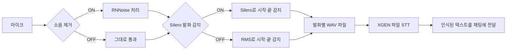

# DEX 음성 처리 흐름

## 일반 핸즈프리: 파일 STT 유지

말을 끝내면 한 발화를 WAV 파일로 묶어 XGEN에 보낸다. 소음 제거와 Silero는 각각 독립된 선택이며, **Silero OFF여도 기존 RMS(소리 크기) 감지는 동작한다.**



소음 제거는 보내는 음성을 바꾸고, 발화 감지는 파일을 언제 시작·종료할지 결정한다. 서버의 STT/VAD 설정은 변경하지 않는다.

## 세 가지 입력 경로

| 경로 | 녹음 종료 기준 | XGEN 전송 |
| --- | --- | --- |
| 일반 핸즈프리 | Silero ON: 모델 종료 / OFF: 기존 RMS | 발화별 WAV, `POST /api/audio/stt/transcribe` |
| 일반 마이크 녹음 | 사용자가 중지하거나 30초 상한 | WAV, 같은 파일 STT API |
| 기존 빠른 조작 설정의 실시간 음성 | Silero ON: 모델 종료 후 1.2초 hold / OFF: 서버 final, 30초 상한 | PCM, `WS /api/audio/stt/stream` |

기존 `handsfree.ts`의 빠른 조작 ON + workflow가 있는 경우의 실시간 분기는 유지했다. 일반 파일 경로를 강제로 WebSocket으로 바꾸지 않는다. 현재 실시간 경로도 main의 `planBeforeAct: true`로 최종 발화 뒤 채팅 계획까지 조작을 보류한다.

일반 마이크 녹음에서 Silero ON일 때 발화가 감지되지 않은 녹음은 업로드하지 않는다. 실시간 경로에서 Silero OFF는 RMS fallback이 아니라 서버 감지를 사용하며 무음·주변 소리도 서버로 전송한다.

## 전처리와 파일 생성

모든 입력은 `getUserMedia` → PCM16/16kHz/mono/64ms → `processed-capture.ts` → main IPC → Python 워커 순서로 처리한다. RNNoise와 Silero를 모두 끄면 Python을 시작하지 않는다. AEC 활성화와 브라우저 noiseSuppression 비활성화를 요청하지만 실제 장치의 효과는 미검증이다.

파일 핸즈프리는 기존 MediaRecorder의 원음 WebM 대신 **처리된 PCM을 WAV로 묶는다**. 기존 파일 STT API와 `quickChat.submit(text)` 호출은 유지한다. 그래야 소음 제거를 거친 음성이 서버에 전달된다.

- RMS 기준은 `0.015`, 시작 `150ms`, 종료 `900ms`를 유지한다. 이제 처리된 64ms PCM 블록에서 계산하므로 예전 WebAudio analyser의 측정 간격과는 다르며, RNNoise 적용 후 감도는 현장 재검증이 필요하다.
- Silero ON은 `inSpeech`/발화 이벤트를 사용하고 종료 뒤 RMS용 900ms 대기를 추가하지 않는다.
- 감지 확정 전 음성은 최대 1.2초 보관한다. 기존 MediaRecorder 코드에는 주석과 달리 실제 pre-roll이 없었다. 새 PCM 버퍼 길이는 현장 보정 전의 임시값이다.
- 감지 확정 이후 400ms 미만 구간은 버리고, 30초가 되면 한 파일을 마친다. 400ms는 실제 발성 길이가 아니라 경과 시간이다.
- 전사 중 다음 음성은 기존 방식처럼 수집하지 않는다. 핸즈프리를 끄면 진행 중인 녹음을 취소하며, 늦게 도착한 전사 결과를 채팅에 보내지 않는다.
- 파일 STT 실패는 오류를 표시하고 다음 발화를 기다린다. 워커 실패는 마이크를 닫고 원음으로 자동 전환하지 않는다.

워커 큐 상한은 128,000 bytes(4초), 응답 제한은 10초다. 수동 녹음 정상 종료는 워커 finish의 잔여 PCM까지 WAV에 포함한다. 핸즈프리는 워커를 계속 유지하고 이미 반환된 PCM을 발화별로 묶는다. WebSocket의 마지막 640bytes 미만 조각도 전송한다.

## 실행·설정·로그

```sh
cd /Users/somin/Desktop/plateer/xgen-dex-core/apps/desktop
DEX_AUDIO_ROOT=/Users/somin/Desktop/plateer/xgen-audio-preprecessing npm run dev
```

**음성 설정 → DEX 소음 제거 / DEX Silero 발화 감지(VAD)**에서 조절한다. 둘 다 기본 OFF이며 마이크를 껐다 켜면 적용된다. 인접 라이브러리의 `.venv`와 `.local/rnnoise/librnnoise.dylib`를 사용하며, 다른 위치는 `DEX_AUDIO_ROOT`, 실행 파일은 `DEX_AUDIO_PYTHON`, RNNoise는 `XGEN_RNNOISE_LIBRARY`로 지정한다.

터미널의 `[audio-preprocess] ready`는 선택된 옵션, `pcm-active`는 첫 PCM 처리 성공을 나타낸다. 로그의 `vad:false`는 **Silero OFF**이며 일반 핸즈프리의 RMS까지 꺼졌다는 뜻이 아니다. `speech_start`/`speech_end`는 Silero 이벤트다. 설정 → 일반 → 설치 → 진단 로그 복사에서도 볼 수 있다.

## 확인한 범위

2026-10-17 기준. 이전 전처리→Core 검증에서는 깨끗한 한국어와 공개 행사장 소음 0dB 혼합을 네 조합으로 전송하여 WS 8회 + 파일 8회 모두 `안녕하세요. 오늘 날씨가 정말 좋네요.`로 일치했다. 이 테스트는 `voice-loop`의 구간 판단을 우회하므로 실시간 마이크 전체 경로 검증은 아니다. 소음 제거 OFF도 맞았기 때문에 인식률 향상을 입증한 결과도 아니다.

이번 파일 핸즈프리 검증은 `verify/handsfree-smoke.cjs`에서 실제 React 훅·PCM 캡처 코드·Python을 실행한다. 마이크/시간은 모의 입력이고 채팅 전송은 테스트 수신기로 대체한다. 기본 실행은 파일 STT 응답도 모의 처리하고, `DEX_AUDIO_REAL_STT=1`이면 기존 로그인으로 실제 Core 파일 STT를 호출한다. 실제 창의 마이크 장치·생산용 IPC 핸들러 전체를 검증하는 테스트는 아니다.

이번 실행에서 네 조합 모두 발화당 WAV 1개, WebSocket 시작 0회였으며, 실제 Core 파일 STT 네 번 모두 `안녕하세요. 오늘 날씨가 정말 좋네요.`로 일치했다. Silero ON은 실제 시작·종료 이벤트를 확인했고 OFF에서는 이벤트 없이 RMS로 파일을 만들었다.

추가 회귀 검증에서 무음 업로드 방지, 녹음 취소, 중지 후 늦은 STT 결과의 채팅 전송 차단, 30초 파일 상한, 파일 STT 오류 표시·다음 발화 대기를 확인했다. 관련 Node 테스트 24개와 타입 검사가 통과했다.

기존 RMS 기준에서 원본 조용한 샘플은 시작 조건을 통과하지 못했다. 이 동작을 확인하는 검증을 포함했고, 네 조합 비교에는 **클리핑 없이 음량만 4배(+12dB 가량) 높인 샘플**을 사용한다. 앱의 마이크 게인을 바꾸지는 않았다.

```sh
# apps/desktop에서
node --import tsx --test test/audio-preprocessor.test.ts test/processed-capture.test.ts
./node_modules/.bin/electron verify/audio-settings-smoke.cjs
./node_modules/.bin/electron -r tsx/cjs verify/handsfree-smoke.cjs
DEX_AUDIO_REAL_STT=1 ./node_modules/.bin/electron -r tsx/cjs verify/handsfree-smoke.cjs
```

설정 UI 테스트는 모의 저장 응답에 대한 표시·실패 상태를 확인하며 실제 파일 저장/재시작 복원 검증은 아니다. 캡처 단위 테스트는 AEC 옵션 요청을 확인하며 실제 에코 제거 효과를 검사하지 않는다.

## 남은 임시 처리·미검증 범위

실시간 전송 시작의 500ms 무음은 테스트 파일의 첫 인사말 누락을 막은 우회책이다. 서버 VAD가 원인인지, 실제 마이크에서도 필요한지는 미확인이다. 기존 종료 무음 300ms도 뒤의 stop과 별개로 필요한지 분리 검증하지 않았다. **두 무음 보정은 일반 핸즈프리의 파일 업로드에는 적용되지 않는다.**

물리 마이크·스피커, COEX 현장, 30분 상시청취, OS/CPU별 배포 런타임·패키징·서명은 미검증이다. 기존 RMS는 작은 목소리를 놓칠 수 있고 RNNoise가 이를 더 작게 만들 수도 있다. 배포 앱에는 Python·RNNoise 및 라이선스를 별도로 포함해야 한다. 현재 변경은 개발 작업 트리이며 설치 앱 교체·커밋·푸시는 하지 않았다.
